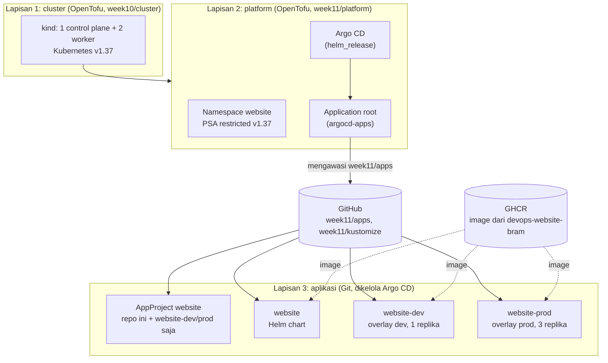

# Kubernetes IaC & GitOps Lab

Lab pribadi untuk membangun platform Kubernetes **sepenuhnya dari kode** dan mengelola aplikasinya secara **GitOps**: cluster multi-node dibuat dengan OpenTofu, Argo CD dipasang sebagai lapisan platform, lalu aplikasi di lingkungan **dev** dan **prod** di-deploy, dipromosikan, dan di-rollback hanya lewat Git.

> **English summary:** Personal lab that builds a Kubernetes platform entirely from code and runs applications GitOps-style. OpenTofu provisions a 3-node kind cluster and a platform layer (namespace with a pinned *restricted* Pod Security level, Argo CD, and a single root Application). Argo CD then deploys a website to **dev** and **prod** from Kustomize overlays (app of apps). Releases are promoted dev → prod through pull requests with the **same image tag** (no rebuild), rolled back with `git revert`, protected by an Argo CD **AppProject** and **CODEOWNERS**, and drift is reverted automatically by self-heal. Further labs manage stateful workloads and persistent volumes with OpenTofu (week 11) and access control as code (week 13): RBAC for five parties verified by an automated `kubectl auth can-i` matrix, a namespace enforcing the *restricted* Pod Security level, and default-deny NetworkPolicies. Week 14 stores application secrets in Git as Sealed Secrets, bound to their namespace and recoverable only with a backed-up controller key. The website image comes from [devops-website-bram](https://github.com/Bram-02/devops-website-bram), whose CI scans and publishes it to GHCR.

**Penyusun:** Bram Naibaho · D3 Teknologi Komputer, Institut Teknologi Del · [LinkedIn](https://www.linkedin.com/in/bram-modestus-naibaho-95866b387/)

---

## Arsitektur



| Lapisan | Pemilik | Isi | Diubah lewat |
|---|---|---|---|
| 1. Cluster | OpenTofu (`week10/cluster`) | Cluster kind 3 node, kubeconfig di file terpisah | `tofu apply` |
| 2. Platform | OpenTofu (`week11/platform`) | Namespace `website` (label PSA), Argo CD, Application `root` | `tofu plan -out` lalu `tofu apply` |
| 3. Aplikasi | Argo CD dari Git (`week11/apps`, `week11/kustomize`) | AppProject, Application website/dev/prod, manifest Kustomize | Pull request ke `main` |

OpenTofu berhenti di bootstrap (Argo CD + satu Application `root`); setelah itu setiap aplikasi dikelola Argo CD dari Git. Satu objek, satu pemilik: namespace `website` milik OpenTofu, sedangkan `website-dev` dan `website-prod` dibuat Argo CD (`CreateNamespace=true` + `managedNamespaceMetadata`).

---

## Struktur repository

```
.
├── week10/
│   ├── cluster/            # Lapisan 1: cluster kind (provider tehcyx/kind ~> 0.13.0)
│   └── platform/           # Alternatif lapisan 2 tanpa GitOps: metrics-server (Helm), website (provider kubernetes)
├── week11/
│   ├── platform/           # Lapisan 2: namespace + PSA, Argo CD 10.17.1, Application root (argocd-apps 2.0.8)
│   ├── apps/               # Diawasi Application root (app of apps)
│   │   ├── project-website.yaml   # AppProject: hanya repo ini, hanya namespace website-dev/prod
│   │   ├── website.yaml           # Helm chart dari devops-website-bram
│   │   ├── website-dev.yaml       # Overlay dev
│   │   └── website-prod.yaml      # Overlay prod, ignoreDifferences replika
│   └── kustomize/website/
│       ├── base/           # ConfigMap, Service, Deployment (dirender dari Helm chart)
│       └── overlays/
│           ├── dev/        # namespace website-dev, 1 replika, label lingkungan=dev
│           └── prod/       # namespace website-prod, 3 replika, batas memori 128Mi
│   ├── opentofu-wordpress/ # Praktikum: Secret (variabel sensitive) + MariaDB + WordPress, bukti emptyDir hilang
│   └── opentofu-pv/        # Praktikum: PersistentVolume (kelas manual, node_affinity, Retain) + PVC + Nginx
├── week13/                 # Keamanan, identitas, akses (lihat week13/README.md)
│   ├── rbac/               # Namespace PSA, RBAC 5 pihak, default deny, uji matriks akses (cek-akses.sh)
│   └── katalog/            # Workload lolos restricted + NetworkPolicy khusus frontend
├── week14/secrets/         # Sealed Secrets: controller (OpenTofu, Helm), SealedSecret katalog-db (lihat README)
├── .github/CODEOWNERS      # Perubahan prod dan Application wajib direview pemilik
│
├── ansible/                # Fondasi: playbook idempoten, perbaikan Nova (KVM ke QEMU) di OpenStack
├── devstack-fix/           # Fondasi: netplan + skrip idempoten + systemd untuk jaringan DevStack
├── docker-website/         # Fondasi: Dockerfile dan Docker Compose
├── opentofu-docker/        # Fondasi: OpenTofu dengan provider Docker
├── opentofu-openstack/     # Fondasi: OpenTofu ke OpenStack (kredensial di luar repository)
├── k8s/                    # Fondasi: Deployment dan Service pertama di k3s
├── monitoring/             # Fondasi: node-exporter, Prometheus, Grafana (password di .env, tidak di-commit)
└── .github/workflows/      # Fondasi: CI build image pertama
```

`week10/platform` dan `week11/platform` sama-sama lapisan 2 dan sama-sama membuat namespace `website`, jadi **pakai salah satu** di atas cluster yang sama. Folder bertanda *Fondasi* adalah latihan dasar (Linux, Git, Docker, CI, IaC, Ansible, monitoring) sebelum lab Kubernetes; versi lengkap dan terpadu ada di [devops-website-bram](https://github.com/Bram-02/devops-website-bram).

---

## Cara menjalankan

Prasyarat: Docker, OpenTofu, kubectl (diuji di Ubuntu 24.04 di WSL2, RAM WSL 3 GB; matikan k3s dulu bila ada).

```bash
# Lapisan 1: cluster (sekitar 2 menit)
cd week10/cluster
tofu init && tofu apply
# kubeconfig ditulis ke ~/.kube/kind-skomawan-lab, tidak menyentuh ~/.kube/config

# Lapisan 2: platform (sekitar 4-8 menit, sebagian besar mengunduh image Argo CD)
cd ../../week11/platform
tofu init
tofu plan -out=rencana.tfplan
tofu apply rencana.tfplan

# Lapisan 3 berjalan sendiri dari Git
KK=~/.kube/kind-skomawan-lab
kubectl --kubeconfig $KK get applications -n argocd
kubectl --kubeconfig $KK get deploy -A --field-selector metadata.name=website -L lingkungan
```

Dashboard Argo CD (jangan membagikan password admin ke mana pun):

```bash
kubectl --kubeconfig $KK port-forward svc/argocd-server -n argocd 8080:443
kubectl --kubeconfig $KK -n argocd get secret argocd-initial-admin-secret -o jsonpath='{.data.password}' | base64 -d; echo
# buka https://localhost:8080, user admin
```

Membongkar dengan urutan yang benar (root dulu agar finalizer membersihkan aplikasi):

```bash
cd week11/platform
tofu destroy -target=helm_release.root_app
tofu destroy
cd ../../week10/cluster
tofu plan -destroy -no-color | grep -E "^  # |^Plan:"   # rencana destroy cluster memuat kunci privat; jangan ditampilkan utuh
tofu destroy -auto-approve -no-color | tail -n 2
```

---

## Alur kerja GitOps yang sudah dibuktikan

### Promosi dev ke prod lewat pull request (tag yang sama, tanpa build ulang)

1. Kode website berubah di `devops-website-bram`; CI (Gitleaks, Trivy, uji halaman) membangun image bertag commit SHA dan mendorongnya ke GHCR.
2. **PR #1** ([rilis ke dev](https://github.com/Bram-02/kubernetes-iac-gitops-lab/pull/1)) mengganti `newTag` di `overlays/dev`. Push ke branch tidak men-deploy apa pun; setelah merge, Argo CD menerapkannya: dev versi 1.2, prod tetap 1.1.
3. **PR #2** ([promosi ke prod](https://github.com/Bram-02/kubernetes-iac-gitops-lab/pull/2)) menyalin **tag yang sama** ke `overlays/prod`. Setelah merge, prod diperbarui dengan rolling update tiga pod satu per satu.

### Rollback dengan `git revert`

Versi yang sengaja rusak (tag image yang tidak ada) dirilis ke dev: pod baru `ImagePullBackOff`, pod lama tetap melayani. `git log` menunjukkan siapa, kapan, dan apa yang diubah; `git revert` memulihkan dev dalam sekitar 30 detik tanpa menghapus riwayat.

### Self-heal dan perbedaan yang diizinkan

| Uji | Hasil |
|---|---|
| Replika dev diubah manual 1 ke 3 | Dikembalikan ke 1 oleh `selfHeal` |
| Replika prod diubah manual 3 ke 5 | Dibiarkan (`ignoreDifferences` pada `/spec/replicas`, untuk HPA) |
| Application uji menargetkan `kube-system` | Ditolak AppProject (`InvalidSpecError`), tidak ada objek dibuat |
| Application dihapus | Finalizer menghapus objeknya; namespace hasil `CreateNamespace` tetap ada |

---

## Keputusan desain

- **Root module terpisah per lapisan.** Cluster dan platform punya state sendiri; platform membaca kubeconfig dari output cluster lewat `terraform_remote_state`. Mengubah platform tidak berisiko menyentuh cluster.
- **Kubeconfig per cluster.** kind menulis ke `~/.kube/kind-skomawan-lab`, sehingga membangun dan menghapus lab tidak merusak akses ke cluster lain.
- **Kustomize: satu image, banyak lingkungan.** Base dirender dari Helm chart yang sama dengan production; overlay hanya memuat perbedaan (namespace, replika, memori, label). Label lingkungan memakai `includeTemplates: true` agar ikut ke pod tanpa mengubah selector.
- **Merge adalah gerbang deploy.** Argo CD hanya mengikuti `main`; perubahan prod dan definisi Application dijaga CODEOWNERS, dan AppProject membatasi repo serta namespace tujuan.
- **Data tetap ada hanya dengan PV.** Praktikum Week 11 membuktikan tabel MariaDB di emptyDir hilang saat Pod diganti, sedangkan halaman nginx di PV + PVC tetap ada, bahkan setelah PV dan PVC dihapus (`Retain`). PV memakai kelas `manual` agar tidak diambil StorageClass bawaan kind, dan `node_affinity` karena hostPath hanya ada di satu dari dua worker.
- **Akses diuji, bukan dicoba-coba.** Week 13 menulis RBAC lima pihak sebagai OpenTofu dan menguji 18 baris matriks akses dengan `kubectl auth can-i --as`. Uji drift menunjukkan `tofu plan` hanya menangkap perubahan pada resource yang dikelolanya; RoleBinding tambahan yang dibuat manual hanya tertangkap oleh uji matriks dan audit `can-i --list`.
- **Rahasia di Git, terenkripsi.** Password Katalog dibuat acak di dalam pipa, di-seal dengan kunci publik controller, lalu di-commit sebagai SealedSecret. Disalin ke namespace lain, file itu gagal dibuka; kunci privat yang hilang membuat semua SealedSecret tidak terbaca sampai kunci dipulihkan dari backup, yang dijaga `.gitignore` agar tidak pernah masuk Git.
- **Keamanan bawaan.** Namespace dikunci Pod Security `restricted` dengan versi tetap; tidak ada state, plan, kubeconfig, atau `.env` di repository (dicek dengan Gitleaks di seluruh riwayat).

## Kendala yang dihadapi

| Kendala | Penyebab | Solusi |
|---|---|---|
| kubectl untuk cluster lain rusak setelah kind dihapus | kind memakai `~/.kube/config` bersama | `kubeconfig_path` terpisah |
| Aplikasi Helm `Progressing` di kind | Ingress tanpa ingress controller | `ingress.enabled=false` lewat Git |
| Sumber daya yatim setelah Application dihapus | Application tanpa finalizer | `resources-finalizer.argocd.argoproj.io` |
| HPA tidak bisa bekerja di kind | Cluster lab tidak memasang metrics-server | `autoscaling.enabled=false` lewat parameter Application |
| Label lingkungan tidak ada di pod | Kustomize `labels` hanya ke metadata objek | `includeTemplates: true` |
| `grep` pada output `tofu show` kosong | Kode warna ANSI | `-no-color` |
